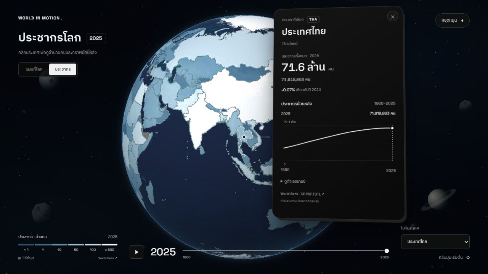

# WORLD IN MOTION

เว็บแอปสำรวจโลกสามมิติและการเปลี่ยนแปลงประชากรผ่านเวลา สร้างด้วย React, TypeScript และ native WebGL บน Canvas เดียว พร้อมข้อมูลรายปีจริงจาก World Bank

เริ่มจากลูกโลกสีธรรมชาติ แล้วสลับเป็นแผนที่ประชากรเพื่อเลือกประเทศ เลื่อนปี หรือเล่นเวลาแบบต่อเนื่อง ดูจำนวนคน แนวโน้มย้อนหลัง และตารางข้อมูลในหน้าเดียว



## ฟีเจอร์ปัจจุบัน

- **หน้าเปิดเต็มจอ** — ลูกโลกขนาดใหญ่กับชื่อ WORLD IN MOTION กดเริ่มแล้วซูมออกเข้าสู่หน้าหลัก โดยใช้ Canvas เดิมตลอด
- **แผนที่โลก** — พื้นผิวโลกสีธรรมชาติ ขอบเขต 240 ประเทศและดินแดน ชี้เพื่อไฮไลต์ คลิกเพื่อหมุนและซูมไปยังประเทศนั้น
- **ข้อมูลประเทศ** — การ์ดลอย 2.5D เชื่อมกับตำแหน่งประเทศ แสดงรูปร่างแผนที่ในโหมดแผนที่โลก และตัวเลข/กราฟในโหมดประชากร
- **แผนที่ประชากร** — สีน้ำเงินหม่นไล่ไปขาว ค่ายิ่งมากยิ่งสว่าง พร้อมคำอธิบายสี พื้นที่ไม่มีข้อมูลใช้สีเทา
- **เส้นเวลา 1960–2025** — ลากเลือกปี หรือกดเล่นให้แถบเวลา จุดบนกราฟ และสีประเทศไหลต่อเนื่องด้วยนาฬิกาเดียวกัน
- **เลขมิเตอร์ทีละหลัก** — จำนวนประชากรและปีบนเส้นเวลาใช้วงล้อแยกแต่ละหลัก เมื่อกดหยุดจะจบที่ค่ารายปีจริงทันที
- **กราฟและตารางย้อนหลัง** — ชี้กราฟเพื่ออ่านค่ารายปี ใช้คีย์บอร์ดได้ และเปิดตารางจำนวนประชากรเต็มได้
- **เปลี่ยนมุมมองอย่างนุ่มนวล** — ผสมสีพื้นผิวจริงกับสีประชากรประมาณ 700 ms สลับกลับกลางทางได้โดยคงมุมกล้องและประเทศที่เลือก
- **ธีมอวกาศ** — UI ดำขาว ฟอนต์ Space Grotesk + IBM Plex Sans Thai พื้นหลังดาว 3 ระยะ ฝุ่นอวกาศลอยช้า และดาวตกสุ่มจาก SVG/CSS
- **การควบคุม** — ลากหมุนพร้อมแรงเฉื่อย เลื่อนล้อหรือ pinch เพื่อซูม เลือกประเทศจากรายการ และปิดการ์ดด้วย Escape

## เริ่มใช้งาน

ใช้ Node.js 22.18+ หรือเวอร์ชันใหม่กว่าที่รองรับการรันไฟล์ TypeScript โดยตรงสำหรับสคริปต์ตรวจข้อมูล

```sh
npm ci
npm run dev
```

เปิด [http://127.0.0.1:5175](http://127.0.0.1:5175) ถ้ามีเซิร์ฟเวอร์นี้เปิดอยู่แล้วให้ใช้ตัวเดิม พอร์ตถูกตั้งแบบ strict จึงต้องว่างก่อนเริ่มรอบใหม่

```sh
npm run build
npm run preview
```

`build` ตรวจ TypeScript และสร้างไฟล์ใน `dist/` ส่วน `preview` เปิดผล build ที่ [http://127.0.0.1:5176](http://127.0.0.1:5176)

## วิธีสำรวจ

1. กด **เริ่มสำรวจ** เพื่อเข้าสู่แผนที่โลกสีธรรมชาติ
2. คลิกประเทศ หรือตั้งค่าจากรายการ **ไปที่ประเทศ** เพื่อเปิดข้อมูล
3. เลือก **ประชากร** ที่มุมซ้ายบนเพื่อแสดงสีตามจำนวนคนและแถบปี
4. ลากแถบเวลา หรือกด **เล่น** เพื่อดูการเปลี่ยนแปลง กดหยุดเพื่อค้างตำแหน่งเดิม
5. กดชื่อเว็บไซต์มุมซ้ายบนเพื่อกลับหน้าเปิด หรือกด **กลับมุมเริ่มต้น** เพื่อล้างประเทศที่เลือกและคืนกล้อง

การเล่นเดินด้วยความเร็ว 700 ms ต่อปี หยุดเมื่อถึงปีสุดท้าย และกดเล่นอีกครั้งเพื่อเริ่มจากปีแรก การลากแถบ สลับมุมมอง กลับหน้าเปิด หรือซ่อนแท็บจะหยุดเล่น โดยการกลับมาสำรวจยังจำปีและประเทศเดิมไว้

| จุดควบคุม | คีย์บอร์ด |
| --- | --- |
| ลูกโลก | ลูกศรหมุน, `+` / `-` ซูม, `Home` คืนกล้อง |
| แถบปี | ลูกศรเลือกทีละปี, `PageUp` / `PageDown` ข้าม 10 ปี, `Home` / `End` ไปต้น/ท้ายช่วง |
| กราฟ | ลูกศรดูข้อมูลรายปี, `Home` / `End` ไปต้น/ท้ายช่วง |
| การ์ดประเทศ | `Escape` ปิด เมื่อไม่ได้โฟกัสรายการประเทศ |

## ข้อมูลและความหมายของภาพเคลื่อนไหว

ข้อมูลที่รวมอยู่ใน repo เป็น snapshot ของ **World Bank · World Development Indicators**, indicator **SP.POP.TOTL**: จำนวนประชากรรวมตามค่าประมาณกลางปี หน่วยคน ไม่ใช่ข้อมูลเรียลไทม์

- ช่วงข้อมูลปัจจุบัน: **1960–2025**
- จับคู่กับแผนที่ได้ **213 ประเทศและดินแดน** จากขอบเขตทั้งหมด 240 พื้นที่
- วันที่ปรับปรุงจาก World Bank ของ snapshot ปัจจุบัน: **2026-11-11**
- ใช้รหัส ISO3 ในการจับคู่ ไม่รวมค่ารวมภูมิภาคหรือกลุ่มรายได้
- ปีเริ่มต้นคือปีล่าสุดที่มีความครอบคลุมอย่างน้อย 95% ของจำนวนพื้นที่สูงสุดในชุดข้อมูล ปัจจุบันคือ 2025
- เกณฑ์สีเป็น **จำนวนคนทั้งหมด ไม่ใช่ความหนาแน่น** และคงช่วงสีเดียวกันทุกปี

| ช่วงสีจากเข้มไปอ่อน | ประชากร |
| --- | --- |
| 1 | ต่ำกว่า 1 ล้าน |
| 2 | 1 ล้าน ถึงน้อยกว่า 10 ล้าน |
| 3 | 10 ล้าน ถึงน้อยกว่า 50 ล้าน |
| 4 | 50 ล้าน ถึงน้อยกว่า 100 ล้าน |
| 5 | 100 ล้าน ถึงน้อยกว่า 500 ล้าน |
| 6 | ตั้งแต่ 500 ล้านขึ้นไป |
| เทา | ไม่มีข้อมูลของพื้นที่/ปีนั้น |

ตำแหน่งบนแถบเวลา จุดกราฟ และสีสามารถอยู่ระหว่างสองปีเพื่อให้เคลื่อนไหวต่อเนื่อง แต่ **ตัวเลขอ้างอิงค่ารายปีจริงของปีที่แสดง** ตัวเลขใหญ่เป็นค่าปัดย่อ ส่วนบรรทัดเล็กและตารางเป็นจำนวนเต็มจริง วงล้อมิเตอร์อาจเห็นเลขระหว่างทางชั่วครู่ขณะหมุน เมื่อหยุดจะจบตรงค่าเป้าหมายจริง

ไม่เติมค่าประชากรที่ขาดด้วยศูนย์ ไม่ลากจุดกราฟข้ามช่วงที่ไม่มีข้อมูล และคำนวณเปอร์เซ็นต์เทียบปีก่อนเฉพาะเมื่อมีข้อมูลครบทั้งสองปี เส้นขอบประเทศเป็นชุดแผนที่คงที่ ไม่ใช่เส้นขอบตามประวัติศาสตร์ของแต่ละปี พื้นผิวโลกก็เป็นภาพคงที่ ไม่ใช่ภาพดาวเทียมสด

## อัปเดตข้อมูลและตรวจงาน

```sh
npm run data:population
npm run check:population
npm run check:playback
npm run build
```

- `data:population` ดึงข้อมูลจาก World Bank API ฟรีโดยไม่ต้องใช้ key ตรวจความครบถ้วนก่อนเขียน snapshot ใหม่ ต้องใช้อินเทอร์เน็ต จากนั้น build/เปิดหน้าใหม่เพื่อใช้ชุดข้อมูลล่าสุด
- `check:population` ตรวจทุกพื้นที่ครบทุกปี การแบ่งสี การจับคู่ ISO3 และสถานะไม่มีข้อมูล ส่งพาธ API JSON ต้นฉบับต่อท้ายคำสั่งเพื่อตรวจ observation ทุกค่ากับต้นฉบับได้
- `check:playback` จำลอง 60/120/144 Hz ตรวจความเร็ว การหยุด/เล่นต่อ การเลือกปี การจบและเริ่มใหม่ ซ่อนแท็บ เฟรมช้า และช่วงข้อมูลที่ขาด
- `globe:countries` สร้าง country paths จากข้อมูล Natural Earth ที่เก็บไว้ใน `public/` โดยใช้ D3/topojson เฉพาะในขั้นเตรียมข้อมูล

`data:refresh`, `globe:land`, `server.mjs` และไฟล์บางส่วนใน `public/` เป็นเครื่องมือ/ทรัพยากรจากต้นแบบเดิม หน้าเว็บ React ปัจจุบันใช้ Vite ซึ่งตั้ง `publicDir: false` ไม่คัดลอกต้นแบบเหล่านี้ไปยังผล build

## เทคโนโลยีและโครงสร้าง

React 19 · TypeScript · Tailwind CSS 4 · Vite 8 · native WebGL · SVG/CSS · Web Animations API

ไม่มี Three.js หรือแพ็กเกจกราฟ/แผนที่เพิ่มใน runtime ฟอนต์ ภาพโลก ขอบเขตประเทศ และ snapshot ประชากรเก็บอยู่ในโปรเจกต์ หน้าเว็บไม่ต้องเรียก API ภายนอกระหว่างเล่นเวลา

```text
components/ui/
  interactive-globe.tsx                 React component และ ref API
  interactive-globe.css                 ลูกโลก tooltip และการ์ดประเทศ
  space-backdrop.tsx                    ดาวหลายชั้น parallax และดาวตกสุ่ม
  interactive-globe-utils/
    globe.ts                            กล้อง pointer inertia และ frame loop
    surface.ts                          WebGL shader, lookup สี และ fade มุมมอง
    countries.ts                        ขอบเขต 240 ประเทศ/ดินแดนที่เตรียมแล้ว
    country-popup.tsx                   การ์ดประเทศ 2.5D
    earth.jpg                           ภาพพื้นผิวโลก
src/
  population/
    population.json                     Snapshot ข้อมูลประชากรพร้อม metadata
    population.ts                       อ่านค่า จัดช่วงสี และตำแหน่งเชิงภาพ
    load-population.ts                  โหลด snapshot เมื่อเลือกประชากร
    playback.ts                         นาฬิกาเศษปีร่วมกัน
    PopulationTimeline.tsx              แถบปีและปุ่มเล่น
    PopulationDetails.tsx               จำนวนคน กราฟ และตาราง
    PopulationLegend.tsx                คำอธิบายสีและแหล่งข้อมูล
    RollingNumber.tsx                   มิเตอร์ตัวเลขแต่ละหลัก
    population.css                     ธีมดำขาวและรูปแบบข้อมูล
  assets/fonts/                         ฟอนต์พร้อมใบอนุญาต OFL
  fonts.css                             @font-face แบบเก็บไฟล์เอง
  space.css                             หน้าเปิดและส่วนควบคุมหลัก
  main.tsx                              React entry
scripts/                                สคริปต์ข้อมูลและชุดตรวจ
demo.tsx                                หน้าเว็บหลักและการเชื่อม component
```

## ใช้ InteractiveGlobe ใน React

โปรเจกต์ตั้ง Tailwind, TypeScript และ alias `@/` ไว้แล้ว และมี `components.json` สำหรับโครงสร้างแบบ shadcn

```tsx
import { useRef } from 'react';
import { InteractiveGlobe, type InteractiveGlobeHandle } from '@/components/ui/interactive-globe';

export function GlobeView() {
  const globe = useRef<InteractiveGlobeHandle>(null);
  return <InteractiveGlobe
    ref={globe}
    style={{ height: 600 }}
    autoRotate
    onSelect={country => console.log(country?.name)}
  />;
}
```

| API | การใช้งาน |
| --- | --- |
| `theme` | สี `ground`, `land`, `arc`, `glow`, `text`, `muted`; `arc` ใช้เป็นสีเน้น ไม่ได้วาดเส้นทางบิน |
| `motion`, `autoRotate` | ควบคุมการเคลื่อนไหว/การหมุนอัตโนมัติ |
| `presentation` | `intro` หรือ `explore` |
| `onReady`, `onEnterComplete` | แจ้งพื้นผิวพร้อมและการซูมจากหน้าเปิดเสร็จ |
| `onSelect` | รับข้อมูล Country หรือ `null` เมื่อ reset |
| `countryColors` | Uint8Array ขนาด 256 × 4 ตาม country index; alpha ระบุว่ามีข้อมูลหรือไม่ |
| `renderCountryDetails` | ปรับเนื้อหาการ์ดของประเทศ |
| `className`, `style` | รูปแบบและขนาด component |
| `ref.selectCountry(id)`, `ref.reset()` | เช่น `selectCountry('764')` เพื่อเลือกไทย หรือคืนกล้อง |
| `ref.setCountryColorFrame(from, to, mix, running?)` | ส่งคู่ lookup และสัดส่วนสีจากนาฬิกาภายนอกโดยไม่อัปเดต React ทุกเฟรม |

## ประสิทธิภาพและการเข้าถึง

- Canvas เดียว วาดทรงกลมด้วย GPU ใน draw call เดียว และ cache country ID atlas
- เตรียม lookup สีทุกปีครั้งเดียว จากนั้นอัปโหลดเฉพาะคู่ปีเมื่อจำเป็น เปลี่ยนสัดส่วนสีผ่าน uniform
- แถบเวลาและ SVG playhead ขยับผ่าน DOM refs; React เปลี่ยนค่าตัวเลขเมื่อข้ามปี ส่วนมิเตอร์ใช้ compositor animation
- ใช้ ResizeObserver, DPR ไม่เกิน 2, delta-time จำกัด 50 ms และ pointer capture
- ลูกโลกหยุดวาดเมื่อซ่อนแท็บ/หลุดจอ และเมื่อไม่มีการเคลื่อนไหวที่ต้องวาด; การเล่นเวลาหยุดเมื่อซ่อนแท็บ
- รองรับคีย์บอร์ด ข้อความกำกับ และตารางข้อมูลสำรอง ฟอนต์เก็บเองจึงไม่ต้องโหลดจาก Google ตอนเปิดเว็บ
- `prefers-reduced-motion` ลดเอฟเฟกต์กล้อง พื้นหลัง มิเตอร์ และการเปลี่ยนมุมมอง; การเล่นเวลาเริ่มเมื่อผู้ใช้กดเท่านั้น
- เปิด `/?globePerf=1` เพื่อดู `data-globe-metrics`, `data-globe-pose` และ `data-color-blend` บน Canvas ค่า `p95DrawMs` เป็นเวลาส่งงานจาก JavaScript ไม่ใช่เวลาทำงาน GPU ทั้งหมด

ความลื่นขึ้นอยู่กับอุปกรณ์และเบราว์เซอร์ ชุดขอบเขตแผนที่ยังทำให้ JavaScript bundle ค่อนข้างใหญ่ และ build อาจแจ้งเตือนขนาด chunk

## แหล่งข้อมูลและเครดิต

- [World Bank — Population, total](https://data.worldbank.org/indicator/SP.POP.TOTL) และ [นิยาม SP.POP.TOTL](https://databank.worldbank.org/metadataglossary/world-development-indicators/series/SP.POP.TOTL): snapshot ข้อมูลประชากร WDI, CC BY 4.0
- [World Bank Indicators API](https://datahelpdesk.worldbank.org/knowledgebase/articles/889392-about-the-indicators-api-documentation): แหล่งสำหรับสคริปต์อัปเดตข้อมูลและ metadata ประเทศ
- [Natural Earth](https://www.naturalearthdata.com/) ผ่าน [world-atlas](https://github.com/topojson/world-atlas): เส้นขอบ countries-50m ข้อมูล Natural Earth เป็น public domain
- [ภาพพื้นผิวจาก Three.js examples](https://threejs.org/examples/textures/planets/earth_atmos_2048.jpg): ใช้เฉพาะไฟล์ภาพ ไม่ได้ใช้ Three.js เป็นตัววาด
- [Space Grotesk](https://github.com/floriankarsten/space-grotesk) และ [IBM Plex Sans Thai](https://github.com/IBM/plex): ฟอนต์ภายใต้ SIL Open Font License ใบอนุญาตรวมอยู่ใน `src/assets/fonts/`

## พื้นหลังอวกาศ

ดาว SVG 298 ดวงแบ่ง 3 ระยะ ขยับตามเมาส์ไม่เกิน 7 px แนวนอน/5 px แนวตั้ง ฝุ่นอวกาศเป็น radial gradients สองชั้นที่เลื่อนและหมุนช้ามากผ่าน CSS transform ไม่มี blur/filter ขนาดใหญ่ และไม่มี Canvas หรือไฟล์ภาพเพิ่ม

ดาวตกครั้งละดวงปรากฏแบบสุ่มทุก 30–70 วินาที บริเวณขอบจอ และผ่านไปในประมาณ 0.8–1 วินาที ไม่มีเสียง ไม่ไล่เล่นเหตุการณ์ที่พลาดไประหว่างซ่อนแท็บ เอฟเฟกต์หยุดเมื่อซ่อนแท็บ หลุดจอ หรือเปิดโหมดลดการเคลื่อนไหว และไม่เปิด parallax บนจอสัมผัส

`SpaceBackdrop` ใช้ React.memo เพื่อไม่วาด star DOM ใหม่ตามตัวเลขรายปี JavaScript อัปเดตตำแหน่งแค่เมื่อขยับเมาส์ (รวม event ด้วย RAF) และเมื่อตั้ง/เล่นดาวตก แอนิเมชันต่อเนื่องของฝุ่นและดาวใช้ CSS ที่ transform/opacity เท่านั้น รูปแบบอยู่ใน `components/ui/space-backdrop.css`
