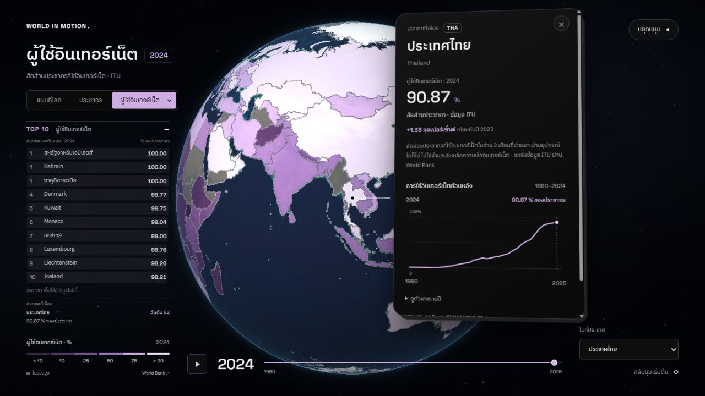
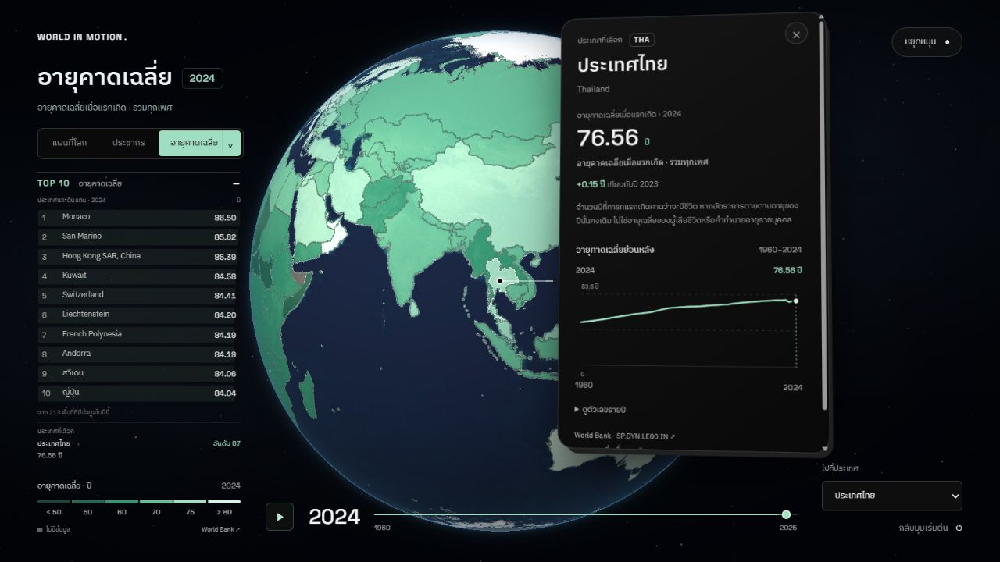

# WORLD IN MOTION

**เว็บจริง: [worldinmotion.vercel.app](https://worldinmotion.vercel.app/)**

เว็บแอปสำรวจโลกสามมิติผ่านข้อมูลประชากร GDP ต่อหัวแบบปรับเงินเฟ้อ อายุคาดเฉลี่ย และผู้ใช้อินเทอร์เน็ต สร้างด้วย React, TypeScript และ native WebGL บน Canvas เดียว พร้อมข้อมูลรายปีจริงจาก World Bank

เริ่มจากลูกโลกสีธรรมชาติ ใช้แถบสามช่องเพื่อสลับมุมมองและเลือกหมวดข้อมูล เลือกประเทศ เลื่อนปี หรือเล่นเวลาแบบต่อเนื่อง ดูแนวโน้มย้อนหลัง ตารางข้อมูล และ Top 10 ในหน้าเดียว สลับหัวข้อแล้วคงประเทศ กล้อง และปีเดิม พร้อมสลับ GDP ระหว่างบาทกับดอลลาร์



## ฟีเจอร์ปัจจุบัน

- **เมนูข้อมูลช่องที่สาม** — เก็บทางลัดแผนที่โลกและประชากรไว้ ช่องสุดท้ายจำตัวชี้วัดล่าสุด กดชื่อเพื่อกลับเข้าโหมดนั้น หรือกดลูกศรเพื่อเลือกหมวดเศรษฐกิจ/สุขภาพ/สังคม เมนูลอยไม่ดันรายการ Top 10
- **อายุคาดเฉลี่ย** — ข้อมูลจริงจาก World Bank ธีมเขียวมรกตถึงมิ้นต์ พร้อม Top 10 กราฟ ตารางย้อนหลัง และความเปลี่ยนแปลงเป็นจำนวนปี
- **ผู้ใช้อินเทอร์เน็ต** — ข้อมูล ITU ผ่าน World Bank ธีมม่วงถึงลาเวนเดอร์ กราฟ 0–100% พร้อม Top 10 และความเปลี่ยนแปลงเป็นจุดเปอร์เซ็นต์
- **หน้าเปิดเต็มจอ** — ลูกโลกขนาดใหญ่กับชื่อ WORLD IN MOTION กดเริ่มแล้วซูมออกเข้าสู่หน้าหลัก โดยใช้ Canvas เดิมตลอด
- **แผนที่โลก** — พื้นผิวโลกสีธรรมชาติ ขอบเขต 240 ประเทศและดินแดน ชี้เพื่อไฮไลต์ คลิกเพื่อหมุนและซูมไปยังประเทศนั้น
- **ข้อมูลประเทศ** — การ์ดลอย 2.5D เชื่อมกับตำแหน่งประเทศ แสดงรูปร่างแผนที่ในโหมดแผนที่โลก และตัวเลข/กราฟในทุกตัวชี้วัด
- **แผนที่ประชากร** — สีน้ำเงินหม่นไล่ไปขาว ค่ายิ่งมากยิ่งสว่าง พร้อมคำอธิบายสี พื้นที่ไม่มีข้อมูลใช้สีเทา
- **GDP ต่อหัว** — ธีมทองแชมเปญ ใช้ข้อมูลปรับเงินเฟ้อราคาปี 2015 พร้อมคำอธิบายความหมายใน popup
- **Top 10 ตามปี** — จัดอันดับประชากร GDP ต่อหัว อายุคาดเฉลี่ย และผู้ใช้อินเทอร์เน็ต เลื่อนสลับตำแหน่งอย่างนุ่มนวล คลิกแถวเพื่อหมุนโลกและเปิดข้อมูลประเทศ พร้อมแสดงอันดับประเทศที่เลือกเมื่ออยู่นอกสิบอันดับ
- **เงินบาท/ดอลลาร์** — GDP เริ่มที่เงินบาท สลับเป็น US$ ได้ทั้งกราฟ ตาราง มิเตอร์ และอันดับ โดยคงปี ประเทศ และการเล่นเวลา ใช้อัตราแลกเปลี่ยนเฉลี่ยปีฐาน 2015
- **เส้นเวลา 1960–2025** — ลากเลือกปี หรือกดเล่นให้แถบเวลา จุดบนกราฟ และสีประเทศไหลต่อเนื่องด้วยนาฬิกาเดียวกัน
- **เลขมิเตอร์ทีละหลัก** — จำนวนประชากรและปีบนเส้นเวลาใช้วงล้อแยกแต่ละหลัก เมื่อกดหยุดจะจบที่ค่ารายปีจริงทันที
- **กราฟและตารางย้อนหลัง** — ชี้กราฟเพื่ออ่านค่ารายปี ใช้คีย์บอร์ดได้ และเปิดตารางค่ารายปีเต็มได้
- **เปลี่ยนมุมมองอย่างนุ่มนวล** — ผสมสีพื้นผิวจริงกับสีประชากรประมาณ 700 ms สลับกลับกลางทางได้โดยคงมุมกล้องและประเทศที่เลือก
- **ธีมอวกาศ** — UI ดำขาว ฟอนต์ Space Grotesk + IBM Plex Sans Thai พื้นหลังดาว 3 ระยะ ฝุ่นอวกาศลอยช้า และดาวตกสุ่มจาก SVG/CSS
- **การควบคุม** — ลากหมุนพร้อมแรงเฉื่อย เลื่อนล้อหรือ pinch เพื่อซูม เลือกประเทศจากรายการ และปิดการ์ดด้วย Escape

## เริ่มใช้งาน

ใช้ Node.js 22.18+ หรือเวอร์ชันใหม่กว่าที่รองรับการรันไฟล์ TypeScript โดยตรงสำหรับสคริปต์ตรวจข้อมูล

```sh
npm ci
npm run dev
```

เปิด [http://127.0.0.1:5175](http://127.0.0.1:5175) ถ้ามีเซิร์ฟเวอร์นี้เปิดอยู่แล้วให้ใช้ตัวเดิม พอร์ตถูกตั้งแบบ strict จึงต้องว่างก่อนเริ่มรอบใหม่

```sh
npm run build
npm run preview
```

`build` ตรวจ TypeScript และสร้างไฟล์ใน `dist/` ส่วน `preview` เปิดผล build ที่ [http://127.0.0.1:5176](http://127.0.0.1:5176)

## วิธีสำรวจ

1. กด **เริ่มสำรวจ** เพื่อเข้าสู่แผนที่โลกสีธรรมชาติ
2. คลิกประเทศ หรือตั้งค่าจากรายการ **ไปที่ประเทศ** เพื่อเปิดข้อมูล
3. เลือก **ประชากร** ที่มุมซ้ายบนเพื่อแสดงสีตามจำนวนคนและแถบปี
4. ลากแถบเวลา หรือกด **เล่น** เพื่อดูการเปลี่ยนแปลง กดหยุดเพื่อค้างตำแหน่งเดิม
5. กด **▾** ในช่องที่สามเพื่อเลือก **เศรษฐกิจ → GDP ต่อหัว**, **สุขภาพ → อายุคาดเฉลี่ย** หรือ **สังคม → ผู้ใช้อินเทอร์เน็ต** กดชื่อช่องเพื่อกลับเข้าหัวข้อล่าสุด หากเป็น GDP ใช้ **฿ THB / $ USD** เพื่อสลับหน่วย
6. ดู **TOP 10** ด้านซ้าย คลิกประเทศเพื่อหมุนไปหา หรือย่อรายการด้วยปุ่มหัวรายการ
7. กดชื่อเว็บไซต์มุมซ้ายบนเพื่อกลับหน้าเปิด หรือกด **กลับมุมเริ่มต้น** เพื่อล้างประเทศที่เลือกและคืนกล้อง

การเล่นเดินด้วยความเร็ว 700 ms ต่อปี หยุดเมื่อถึงปีสุดท้าย และกดเล่นอีกครั้งเพื่อเริ่มจากปีแรก การลากแถบ สลับมุมมอง กลับหน้าเปิด หรือซ่อนแท็บจะหยุดเล่น โดยการกลับมาสำรวจยังจำปีและประเทศเดิมไว้

| จุดควบคุม | คีย์บอร์ด |
| --- | --- |
| ลูกโลก | ลูกศรหมุน, `+` / `-` ซูม, `Home` คืนกล้อง |
| แถบปี | ลูกศรเลือกทีละปี, `PageUp` / `PageDown` ข้าม 10 ปี, `Home` / `End` ไปต้น/ท้ายช่วง |
| กราฟ | ลูกศรดูข้อมูลรายปี, `Home` / `End` ไปต้น/ท้ายช่วง |
| การ์ดประเทศ | `Escape` ปิด เมื่อไม่ได้โฟกัสรายการประเทศ |

## เมนูหมวดและช่วงข้อมูล

แถบมุมซ้ายบนมีสามช่องเสมอ: **แผนที่โลก | ประชากร | หัวข้อที่เลือกล่าสุด ▾** เมนูหมวดเปิดลอยเหนือแผนที่โดยไม่ดัน Top 10 กด Escape หรือคลิกนอกเมนูเพื่อปิด ใช้ลูกศรขึ้น/ลง และ Home/End เลือกรายการได้ ลูกศรเป็น SVG ที่จัดกึ่งกลางปุ่ม

| หมวด | หัวข้อ | ช่วงปีใน snapshot | หน่วย / ธีม |
| --- | --- | --- | --- |
| ทางลัด | ประชากร | 1960–2025 | คน / น้ำเงินถึงขาว |
| เศรษฐกิจ | GDP ต่อหัว | 1960–2025 | บาทเริ่มต้น หรือ US$ ราคาปี 2015 / ทองแชมเปญ |
| สุขภาพ | อายุคาดเฉลี่ย | 1960–2024 | ปี / เขียวมรกตถึงมิ้นต์ |
| สังคม | ผู้ใช้อินเทอร์เน็ต | 1990–2025 | % ของประชากร / ม่วงถึงลาเวนเดอร์ |

ช่วงเวลาร่วมของเว็บยังเป็น 1960–2025 การสลับหมวดหยุดเล่นโดยคงปี ประเทศ กล้อง และตำแหน่งเศษปี ไม่เปลี่ยนไปปีอื่นให้อัตโนมัติ อายุคาดเฉลี่ยไม่มีข้อมูลปี 2025 ส่วนอินเทอร์เน็ตปี 2025 มีเพียง 10 พื้นที่ เทียบกับ 182 พื้นที่ในปี 2024 เว็บแจ้งความครอบคลุมและไม่ใช้ค่าปีอื่นแทนปีที่ขาด

## ข้อมูลและความหมายของภาพเคลื่อนไหว

ข้อมูลที่รวมอยู่ใน repo เป็น snapshot ของ **World Bank · World Development Indicators**, indicator **SP.POP.TOTL**: จำนวนประชากรรวมตามค่าประมาณกลางปี หน่วยคน ไม่ใช่ข้อมูลเรียลไทม์

- ช่วงข้อมูลปัจจุบัน: **1960–2025**
- จับคู่กับแผนที่ได้ **213 ประเทศและดินแดน** จากขอบเขตทั้งหมด 240 พื้นที่
- วันที่ปรับปรุงจาก World Bank ของ snapshot ปัจจุบัน: **2026-11-11**
- ใช้รหัส ISO3 ในการจับคู่ ไม่รวมค่ารวมภูมิภาคหรือกลุ่มรายได้
- ปีเริ่มต้นคือปีล่าสุดที่มีความครอบคลุมอย่างน้อย 95% ของจำนวนพื้นที่สูงสุดในชุดข้อมูล ปัจจุบันคือ 2025
- เกณฑ์สีเป็น **จำนวนคนทั้งหมด ไม่ใช่ความหนาแน่น** และคงช่วงสีเดียวกันทุกปี

| ช่วงสีจากเข้มไปอ่อน | ประชากร |
| --- | --- |
| 1 | ต่ำกว่า 1 ล้าน |
| 2 | 1 ล้าน ถึงน้อยกว่า 10 ล้าน |
| 3 | 10 ล้าน ถึงน้อยกว่า 50 ล้าน |
| 4 | 50 ล้าน ถึงน้อยกว่า 100 ล้าน |
| 5 | 100 ล้าน ถึงน้อยกว่า 500 ล้าน |
| 6 | ตั้งแต่ 500 ล้านขึ้นไป |
| เทา | ไม่มีข้อมูลของพื้นที่/ปีนั้น |

ตำแหน่งบนแถบเวลา จุดกราฟ และสีสามารถอยู่ระหว่างสองปีเพื่อให้เคลื่อนไหวต่อเนื่อง แต่ **ตัวเลขอ้างอิงค่ารายปีจริงของปีที่แสดง** ตัวเลขใหญ่เป็นค่าปัดย่อ ส่วนบรรทัดเล็กและตารางเป็นจำนวนเต็มจริง วงล้อมิเตอร์อาจเห็นเลขระหว่างทางชั่วครู่ขณะหมุน เมื่อหยุดจะจบตรงค่าเป้าหมายจริง

ไม่เติมค่าประชากรที่ขาดด้วยศูนย์ ไม่ลากจุดกราฟข้ามช่วงที่ไม่มีข้อมูล และคำนวณเปอร์เซ็นต์เทียบปีก่อนเฉพาะเมื่อมีข้อมูลครบทั้งสองปี เส้นขอบประเทศเป็นชุดแผนที่คงที่ ไม่ใช่เส้นขอบตามประวัติศาสตร์ของแต่ละปี พื้นผิวโลกก็เป็นภาพคงที่ ไม่ใช่ภาพดาวเทียมสด

## อัปเดตข้อมูลและตรวจงาน

```sh
npm run data:population
npm run check:population
npm run check:playback
npm run check:indicators
npm run check:life
npm run check:internet
npm run check:rankings
npm run build
```

- `data:population` ดึงข้อมูลจาก World Bank API ฟรีโดยไม่ต้องใช้ key ตรวจความครบถ้วนก่อนเขียน snapshot ใหม่ ต้องใช้อินเทอร์เน็ต จากนั้น build/เปิดหน้าใหม่เพื่อใช้ชุดข้อมูลล่าสุด
- `check:population` ตรวจทุกพื้นที่ครบทุกปี การแบ่งสี การจับคู่ ISO3 และสถานะไม่มีข้อมูล ส่งพาธ API JSON ต้นฉบับต่อท้ายคำสั่งเพื่อตรวจ observation ทุกค่ากับต้นฉบับได้
- `check:playback` จำลอง 60/120/144 Hz ตรวจความเร็ว การหยุด/เล่นต่อ การเลือกปี การจบและเริ่มใหม่ ซ่อนแท็บ เฟรมช้า และช่วงข้อมูลที่ขาด
- `globe:countries` สร้าง country paths จากข้อมูล Natural Earth ที่เก็บไว้ใน `public/` โดยใช้ D3/topojson เฉพาะในขั้นเตรียมข้อมูล

`data:refresh`, `globe:land`, `server.mjs` และไฟล์บางส่วนใน `public/` เป็นเครื่องมือ/ทรัพยากรจากต้นแบบเดิม หน้าเว็บ React ปัจจุบันใช้ Vite ซึ่งตั้ง `publicDir: false` ไม่คัดลอกต้นแบบเหล่านี้ไปยังผล build

## เทคโนโลยีและโครงสร้าง

React 19 · TypeScript · Tailwind CSS 4 · Vite 8 · native WebGL · SVG/CSS · Web Animations API

เมนูหมวดอยู่ใน src/indicators/IndicatorSwitcher.tsx และนิยามทั้งสี่ตัวชี้วัดอยู่ใน src/indicators/indicators.ts ข้อมูล GDP อายุคาดเฉลี่ย และอินเทอร์เน็ตแยกเป็น snapshot ที่โหลดและ cache เมื่อเลือกหัวข้อนั้น

ไม่มี Three.js หรือแพ็กเกจกราฟ/แผนที่เพิ่มใน runtime ฟอนต์ ภาพโลก ขอบเขตประเทศ และ snapshot ประชากรเก็บอยู่ในโปรเจกต์ หน้าเว็บไม่ต้องเรียก API ภายนอกระหว่างเล่นเวลา

```text
components/ui/
  interactive-globe.tsx                 React component และ ref API
  interactive-globe.css                 ลูกโลก tooltip และการ์ดประเทศ
  space-backdrop.tsx                    ดาวหลายชั้น parallax และดาวตกสุ่ม
  interactive-globe-utils/
    globe.ts                            กล้อง pointer inertia และ frame loop
    surface.ts                          WebGL shader, lookup สี และ fade มุมมอง
    countries.ts                        ขอบเขต 240 ประเทศ/ดินแดนที่เตรียมแล้ว
    country-popup.tsx                   การ์ดประเทศ 2.5D
    earth.jpg                           ภาพพื้นผิวโลก
src/
  population/
    population.json                     Snapshot ข้อมูลประชากรพร้อม metadata
    population.ts                       อ่านค่า จัดช่วงสี และตำแหน่งเชิงภาพ
    load-population.ts                  โหลด snapshot เมื่อเลือกประชากร
    playback.ts                         นาฬิกาเศษปีร่วมกัน
    PopulationTimeline.tsx              แถบปีและปุ่มเล่น
    PopulationDetails.tsx               จำนวนคน กราฟ และตาราง
    PopulationLegend.tsx                คำอธิบายสีและแหล่งข้อมูล
    RollingNumber.tsx                   มิเตอร์ตัวเลขแต่ละหลัก
    population.css                     ธีมดำขาวและรูปแบบข้อมูล
  assets/fonts/                         ฟอนต์พร้อมใบอนุญาต OFL
  fonts.css                             @font-face แบบเก็บไฟล์เอง
  space.css                             หน้าเปิดและส่วนควบคุมหลัก
  main.tsx                              React entry
scripts/                                สคริปต์ข้อมูลและชุดตรวจ
demo.tsx                                หน้าเว็บหลักและการเชื่อม component
```

## ใช้ InteractiveGlobe ใน React

โปรเจกต์ตั้ง Tailwind, TypeScript และ alias `@/` ไว้แล้ว และมี `components.json` สำหรับโครงสร้างแบบ shadcn

```tsx
import { useRef } from 'react';
import { InteractiveGlobe, type InteractiveGlobeHandle } from '@/components/ui/interactive-globe';

export function GlobeView() {
  const globe = useRef<InteractiveGlobeHandle>(null);
  return <InteractiveGlobe
    ref={globe}
    style={{ height: 600 }}
    autoRotate
    onSelect={country => console.log(country?.name)}
  />;
}
```

| API | การใช้งาน |
| --- | --- |
| `theme` | สี `ground`, `land`, `arc`, `glow`, `text`, `muted`; `arc` ใช้เป็นสีเน้น ไม่ได้วาดเส้นทางบิน |
| `motion`, `autoRotate` | ควบคุมการเคลื่อนไหว/การหมุนอัตโนมัติ |
| `presentation` | `intro` หรือ `explore` |
| `onReady`, `onEnterComplete` | แจ้งพื้นผิวพร้อมและการซูมจากหน้าเปิดเสร็จ |
| `onSelect` | รับข้อมูล Country หรือ `null` เมื่อ reset |
| `countryColors` | Uint8Array ขนาด 256 × 4 ตาม country index; alpha ระบุว่ามีข้อมูลหรือไม่ |
| `renderCountryDetails` | ปรับเนื้อหาการ์ดของประเทศ |
| `className`, `style` | รูปแบบและขนาด component |
| `ref.selectCountry(id)`, `ref.reset()` | เช่น `selectCountry('764')` เพื่อเลือกไทย หรือคืนกล้อง |
| `ref.setCountryColorFrame(from, to, mix, running?)` | ส่งคู่ lookup และสัดส่วนสีจากนาฬิกาภายนอกโดยไม่อัปเดต React ทุกเฟรม |

## ประสิทธิภาพและการเข้าถึง

- Canvas เดียว วาดทรงกลมด้วย GPU ใน draw call เดียว และ cache country ID atlas
- เตรียม lookup สีทุกปีครั้งเดียว จากนั้นอัปโหลดเฉพาะคู่ปีเมื่อจำเป็น เปลี่ยนสัดส่วนสีผ่าน uniform
- แถบเวลาและ SVG playhead ขยับผ่าน DOM refs; React เปลี่ยนค่าตัวเลขเมื่อข้ามปี ส่วนมิเตอร์ใช้ compositor animation
- ใช้ ResizeObserver, DPR ไม่เกิน 2, delta-time จำกัด 50 ms และ pointer capture
- ลูกโลกหยุดวาดเมื่อซ่อนแท็บ/หลุดจอ และเมื่อไม่มีการเคลื่อนไหวที่ต้องวาด; การเล่นเวลาหยุดเมื่อซ่อนแท็บ
- รองรับคีย์บอร์ด ข้อความกำกับ และตารางข้อมูลสำรอง ฟอนต์เก็บเองจึงไม่ต้องโหลดจาก Google ตอนเปิดเว็บ
- `prefers-reduced-motion` ลดเอฟเฟกต์กล้อง พื้นหลัง มิเตอร์ และการเปลี่ยนมุมมอง; การเล่นเวลาเริ่มเมื่อผู้ใช้กดเท่านั้น
- เปิด `/?globePerf=1` เพื่อดู `data-globe-metrics`, `data-globe-pose` และ `data-color-blend` บน Canvas ค่า `p95DrawMs` เป็นเวลาส่งงานจาก JavaScript ไม่ใช่เวลาทำงาน GPU ทั้งหมด

ความลื่นขึ้นอยู่กับอุปกรณ์และเบราว์เซอร์ ชุดขอบเขตแผนที่ยังทำให้ JavaScript bundle ค่อนข้างใหญ่ และ build อาจแจ้งเตือนขนาด chunk

## แหล่งข้อมูลและเครดิต

- [World Bank — Population, total](https://data.worldbank.org/indicator/SP.POP.TOTL) และ [นิยาม SP.POP.TOTL](https://databank.worldbank.org/metadataglossary/world-development-indicators/series/SP.POP.TOTL): snapshot ข้อมูลประชากร WDI, CC BY 4.0
- [World Bank Indicators API](https://datahelpdesk.worldbank.org/knowledgebase/articles/889392-about-the-indicators-api-documentation): แหล่งสำหรับสคริปต์อัปเดตข้อมูลและ metadata ประเทศ
- [Natural Earth](https://www.naturalearthdata.com/) ผ่าน [world-atlas](https://github.com/topojson/world-atlas): เส้นขอบ countries-50m ข้อมูล Natural Earth เป็น public domain
- [ภาพพื้นผิวจาก Three.js examples](https://threejs.org/examples/textures/planets/earth_atmos_2048.jpg): ใช้เฉพาะไฟล์ภาพ ไม่ได้ใช้ Three.js เป็นตัววาด
- [Space Grotesk](https://github.com/floriankarsten/space-grotesk) และ [IBM Plex Sans Thai](https://github.com/IBM/plex): ฟอนต์ภายใต้ SIL Open Font License ใบอนุญาตรวมอยู่ใน `src/assets/fonts/`

## พื้นหลังอวกาศ

ดาว SVG 298 ดวงแบ่ง 3 ระยะ ขยับตามเมาส์ไม่เกิน 7 px แนวนอน/5 px แนวตั้ง ฝุ่นอวกาศเป็น radial gradients สองชั้นที่เลื่อนและหมุนช้ามากผ่าน CSS transform ไม่มี blur/filter ขนาดใหญ่ และไม่มี Canvas หรือไฟล์ภาพเพิ่ม

ดาวตกครั้งละดวงปรากฏแบบสุ่มทุก 30–70 วินาที บริเวณขอบจอ และผ่านไปในประมาณ 0.8–1 วินาที ไม่มีเสียง ไม่ไล่เล่นเหตุการณ์ที่พลาดไประหว่างซ่อนแท็บ เอฟเฟกต์หยุดเมื่อซ่อนแท็บ หลุดจอ หรือเปิดโหมดลดการเคลื่อนไหว และไม่เปิด parallax บนจอสัมผัส

`SpaceBackdrop` ใช้ React.memo เพื่อไม่วาด star DOM ใหม่ตามตัวเลขรายปี JavaScript อัปเดตตำแหน่งแค่เมื่อขยับเมาส์ (รวม event ด้วย RAF) และเมื่อตั้ง/เล่นดาวตก แอนิเมชันต่อเนื่องของฝุ่นและดาวใช้ CSS ที่ transform/opacity เท่านั้น รูปแบบอยู่ใน `components/ui/space-backdrop.css`

## GDP ต่อหัว · ธีมทองแชมเปญ

เลือก “GDP ต่อหัว” ที่มุมซ้ายบนเพื่อสำรวจ **NY.GDP.PCAP.KD — GDP per capita (constant 2015 US$)** จาก World Bank WDI ใช้ดอลลาร์สหรัฐราคาคงที่ปี 2015 ต่อคนต่อปี จึงปรับผลของการเปลี่ยนแปลงราคาแล้ว ไม่ใช่ GDP ราคาปัจจุบัน ไม่ใช่ PPP และไม่ใช่เงินเดือน/รายได้ที่ทุกคนได้รับเท่ากัน

ข้อมูลรายปีใน `src/indicators/gdp.json` เก็บทศนิยมจาก API โดยไม่ปัดก่อนบันทึก หน้าเว็บแสดงเงินสองตำแหน่งทศนิยม สีไล่จากน้ำตาลเข้มไปทองแชมเปญอ่อนตามช่วง <1,000 / 1,000–5,000 / 5,000–10,000 / 10,000–25,000 / 25,000–50,000 / ≥50,000 US$ ต่อคน โดยใช้เกณฑ์เดียวกันทุกปี พื้นที่ไม่มีข้อมูลเป็นสีเทา กราฟเริ่มแกนตั้งที่ศูนย์และไม่ลากจุดข้ามช่องว่าง

ประชากรและ GDP ใช้ **นาฬิกาเดียวและช่วงปีร่วมกัน** จาก `src/indicators/range.json` จึงคงปี ตำแหน่งเศษปี ประเทศ และกล้องเดิมเมื่อสลับโหมด การสลับโหมดหยุดเล่นเวลาไว้ก่อน ไม่เลื่อนไปหาปีที่มีข้อมูลให้อัตโนมัติ ปัจจุบันช่วงร่วมคือ 1960–2025 โดย GDP ปี 2025 มีค่าที่จับคู่แผนที่ได้ 184 พื้นที่ ความครอบคลุมอาจต่างจากประชากร ให้ดูสถานะของปีที่เลือกเสมอ

สีโลกผสมพาเลตเก่ากับใหม่บน GPU ในประมาณ 700 ms แยกจากการผสมระหว่างสองปี กราฟ จุด ป้ายปี และหน่วยแต้มทองแชมเปญ ส่วน UI พื้นฐานยังดำขาว เลขมิเตอร์จบตรงค่ารายปีของตัวชี้วัดที่กำลังเลือก ไม่หมุนปนคนละหน่วย

- `src/indicators/indicators.ts` — นิยามตัวชี้วัด ช่วงสี หน่วย การจัดรูปแบบ และ lookup GPU
- `src/indicators/load-indicator.ts` — โหลดและ cache snapshot เฉพาะตัวชี้วัดที่เลือก
- `src/indicators/indicators.css` — ธีมทองแชมเปญ
- `npm run data:gdp` — ดึง GDP พร้อมตรวจ metadata ว่าเป็นราคาคงที่ปี 2015 ก่อนบันทึก และอัปเดตช่วงปีร่วม
- `npm run check:indicators` — ตรวจหน่วย ปีฐาน สีทุกปี ข้อมูลขาด และช่วงเวลาร่วม ส่งพาธ API JSON ต้นฉบับต่อท้ายเพื่อตรวจทุก observation ได้
- `npm run data:population` — อัปเดตช่วงปีร่วมหลัง refresh ประชากรด้วยเช่นกัน

แหล่งข้อมูล: https://data.worldbank.org/indicator/NY.GDP.PCAP.KD และ https://databank.worldbank.org/metadataglossary/world-development-indicators/series/NY.GDP.PCAP.KD (World Bank WDI, CC BY 4.0)

## Top 10 และสกุลเงิน

รายการ Top 10 ของตัวชี้วัดทั้งสี่หัวข้อจัดอันดับใหม่ตามค่ารายปีจริง รวมเฉพาะประเทศและดินแดนที่จับคู่แผนที่และมีข้อมูลในปีนั้น ไม่มีการเติมค่าที่ขาด อันดับเสมอใช้อันดับร่วมและรหัส ISO3 เพื่อเรียงอย่างคงที่ แสดงสิบพื้นที่แรก พร้อมจำนวนพื้นที่ที่มีข้อมูลและอันดับของประเทศที่เลือกเมื่ออยู่นอกสิบอันดับ

คลิกแถวเพื่อหมุนโลกไปยังประเทศและเปิดการ์ดข้อมูล รายการเลื่อนตำแหน่งด้วย CSS transform 420 ms และ retarget เมื่อกรอปีเร็ว ไม่มีคิวแอนิเมชันสะสม การจัดอันดับใช้ค่าจริงของปีที่แสดง ไม่จัดอันดับจากตัวเลขระหว่างแอนิเมชัน บนมือถือรายการเริ่มแบบย่อและย่ออีกครั้งหลังเลือกประเทศ

GDP เริ่มต้นด้วย **เงินบาท** สลับเป็น US$ ได้โดยคงประเทศ ปี กล้อง และสถานะการเล่นเวลา หน่วยเปลี่ยนพร้อมกันทั้งตัวเลข กราฟ ตาราง คำอธิบายสี และอันดับ เก็บข้อมูลต้นฉบับเป็น constant 2015 US$ และคำนวณเงินบาทด้วย **34.2477166666666 บาทต่อ US$** ซึ่งเป็นอัตราแลกเปลี่ยนเฉลี่ยปี 2015 จาก World Bank `PA.NUS.FCRF` ใช้อัตราเดียวทุกประเทศทุกปีเพื่อรักษาฐานราคาเดิม ไม่ใช่อัตราปัจจุบันหรือ GDP สกุลบาทที่ดึงมาโดยตรง การ์ดอธิบาย GDP ต่อหัว การปรับเงินเฟ้อ และวิธีแปลงเงินพร้อมแหล่งอ้างอิง

- `npm run data:exchange` อัปเดตอัตราเฉลี่ยปีฐานและ metadata ใน `src/indicators/thb-rate.ts`
- `npm run check:rankings` ตรวจอันดับทุกปีของทั้งสี่ชุดข้อมูล อันดับเสมอ ข้อมูลขาด และความสอดคล้องของสกุลเงิน/สี
- `src/indicators/rankings.ts` เตรียมอันดับครั้งเดียวเมื่อโหลด snapshot
- `src/indicators/TopTen.tsx` และ `rankings.css` แสดงรายการและแอนิเมชัน

แหล่งอัตราแลกเปลี่ยน: [World Bank — Official exchange rate, annual average](https://databank.worldbank.org/metadataglossary/world-development-indicators/series/PA.NUS.FCRF)

## อายุคาดเฉลี่ย · สุขภาพ



เลือกลูกศรช่องที่สาม → สุขภาพ → อายุคาดเฉลี่ย ใช้ SP.DYN.LE00.IN — Life expectancy at birth, total (years) จาก World Bank WDI รวมทุกเพศ Snapshot ปัจจุบันมีข้อมูล 1960–2024 และ 213 พื้นที่ในปี 2024 เก็บค่าทศนิยมจาก API โดยไม่ปัด แสดงสองตำแหน่งบนหน้าจอ

ความหมายคือจำนวนปีที่ทารกแรกเกิดคาดว่าจะมีชีวิตหากอัตราการตายตามอายุของปีนั้นคงเดิม ไม่ใช่อายุเฉลี่ยของผู้เสียชีวิตหรือคำทำนายรายบุคคล ข้อมูลประกอบด้วยค่าประมาณของหน่วยงานต้นทาง ไม่ใช่การวัดประชากรทุกคนโดยตรง

สีคงที่ทุกปี: ต่ำกว่า 50 / 50–ต่ำกว่า 60 / 60–ต่ำกว่า 70 / 70–ต่ำกว่า 75 / 75–ต่ำกว่า 80 / ตั้งแต่ 80 ปี ใช้ #173F35, #22654F, #32936F, #65BC96, #A0DEC1 และ #D9F5E7 ตามลำดับ พื้นที่ไม่มีข้อมูลเป็นสีเทา อันดับใช้ค่าต้นฉบับก่อนปัด และรวมเฉพาะพื้นที่ที่มีข้อมูลในปีนั้น

สลับหมวดแล้วยังคงประเทศ กล้อง ปี และตำแหน่งเศษปีเดิม พร้อมหยุดเล่นเวลาก่อนตามพฤติกรรมเดิม หากเลือกปี 2025 แล้วสลับมาอายุคาดเฉลี่ย เว็บจะแจ้งว่ายังไม่มีข้อมูลปีนั้น ไม่ใช้ค่าปี 2024 แทนและไม่เลื่อนปีให้อัตโนมัติ ความเปลี่ยนแปลงเทียบปีก่อนแสดงเป็นจำนวนปี ส่วน GDP และประชากรยังใช้เปอร์เซ็นต์

- npm run data:life — ดึงข้อมูลและนิยามจาก World Bank ตรวจความครบถ้วนก่อนเขียน snapshot และอัปเดตช่วงปีร่วม
- npm run check:life — ตรวจหน่วย นิยาม ช่วงสีทุกปี ข้อมูลขาด และปีที่เกินช่วงข้อมูล ส่งพาธ API JSON ต่อท้ายเพื่อตรวจทุกค่ากับต้นฉบับได้
- npm run check:rankings — ตรวจอันดับทั้งสี่ตัวชี้วัด
- src/indicators/IndicatorSwitcher.tsx — เมนูหมวด รองรับลูกศร Home/End Escape และคลิกนอกเมนูเพื่อปิด

แหล่งข้อมูล: [World Bank — Life expectancy at birth](https://data.worldbank.org/indicator/SP.DYN.LE00.IN) และ [นิยามและข้อจำกัด](https://databank.worldbank.org/metadataglossary/world-development-indicators/series/SP.DYN.LE00.IN) ภายใต้ CC BY 4.0

## ผู้ใช้อินเทอร์เน็ต · สังคม

เลือกลูกศรช่องที่สาม → สังคม → ผู้ใช้อินเทอร์เน็ต ใช้ IT.NET.USER.ZS จาก International Telecommunication Union (ITU) ผ่าน World Bank WDI วัดสัดส่วนประชากรที่ใช้อินเทอร์เน็ตในช่วงสามเดือนที่ผ่านมา ผ่านอุปกรณ์ใดก็ได้ ไม่ใช่จำนวนซิม ความเร็ว หรือจำนวนสมาชิกอินเทอร์เน็ต

Snapshot ปัจจุบันครอบคลุมปี 1990–2025 มีข้อมูลปี 2024 จำนวน 182 พื้นที่ และปี 2025 เพียง 10 พื้นที่ ดูความครอบคลุมและปีที่เลือกก่อนเปรียบเทียบอันดับเสมอ Top 10 รวมเฉพาะพื้นที่ที่มีข้อมูลปีนั้นและจัดอันดับด้วยค่าต้นฉบับก่อนปัด ปีที่ไม่มีข้อมูลแสดงสีเทาและไม่เติมค่าจากปีก่อน ค่าศูนย์ที่มีในต้นฉบับถือเป็นข้อมูลจริง ส่วนปี 1960–1989 ไม่มีข้อมูลใน snapshot นี้

ธีมม่วงเข้มไปลาเวนเดอร์ใช้เกณฑ์เดียวทุกปี: ต่ำกว่า 10 / 10–ต่ำกว่า 25 / 25–ต่ำกว่า 50 / 50–ต่ำกว่า 75 / 75–ต่ำกว่า 90 / ตั้งแต่ 90% กราฟใช้แกนตั้ง 0–100% คงที่ ตัวเลขแสดงสองตำแหน่งทศนิยม ความเปลี่ยนแปลงเทียบปีก่อนเป็น “จุดเปอร์เซ็นต์” เช่น 40% → 45% เพิ่ม 5 จุดเปอร์เซ็นต์

คงประเทศ กล้อง ปี และตำแหน่งเศษปีเมื่อสลับหมวด ใช้นาฬิกาเดียวกับกราฟ แถบเวลา และการผสมสีบน GPU โหลด snapshot เฉพาะเมื่อเลือกและ cache ไว้ ไม่เรียก API ระหว่างเล่นเวลา

- npm run data:internet — ดึงข้อมูล/นิยามจาก World Bank ตรวจช่วง 0–100% และความครบถ้วนก่อนบันทึก โดยเก็บทศนิยมต้นฉบับ
- npm run check:internet — ตรวจหน่วย นิยาม สีทุกปี ค่าศูนย์ ข้อมูลขาด และการจัดรูปแบบ ส่งพาธ API JSON ต่อท้ายเพื่อตรวจทุกค่ากับต้นฉบับได้
- npm run check:rankings — ตรวจอันดับทั้งสี่ตัวชี้วัด

แหล่งข้อมูล: [World Bank / ITU — Individuals using the Internet](https://data.worldbank.org/indicator/IT.NET.USER.ZS), [นิยามและข้อจำกัด](https://databank.worldbank.org/metadataglossary/world-development-indicators/series/IT.NET.USER.ZS), [ITU DataHub](https://datahub.itu.int/) ภายใต้ CC BY 4.0

## เผยแพร่ผ่าน Vercel

เว็บจริง: **[https://worldinmotion.vercel.app/](https://worldinmotion.vercel.app/)**
จัดการโปรเจกต์: [Vercel Dashboard](https://vercel.com/kungnawanghin/world-in-motion)
Source: [kungnawanghin/world-in-motion](https://github.com/kungnawanghin/world-in-motion) · Production branch: **main**

### ตั้งค่าครั้งแรก

1. เข้าบัญชี Vercel แล้วเลือก **Create New → Project**
2. Import GitHub repository **kungnawanghin/world-in-motion**
3. ใช้ Root Directory เป็น **./** และตรวจค่าด้านล่าง ซึ่งกำหนดไว้ในไฟล์ vercel.json และ package.json
4. กด **Deploy** หาก Vercel ขอรหัสยืนยัน ให้เจ้าของบัญชียืนยันในหน้า Vercel
5. รอจนสถานะ **Ready / Deployed to Production** แล้วเปิดลิงก์ Production ที่ Vercel แสดง

| การตั้งค่า | ค่า |
| --- | --- |
| Application / Framework Preset | Vite |
| Production Branch | main |
| Root Directory | ./ |
| Node.js | 24.x |
| Install Command | npm ci |
| Build Command | npm run build |
| Output Directory | dist |
| Environment Variables | ไม่จำเป็นสำหรับเวอร์ชันปัจจุบัน |

โปรเจกต์ปัจจุบันเชื่อม GitHub และเผยแพร่แล้ว ใช้ลิงก์เว็บจริงด้านบนได้ทันที เมื่อนำ repo ไป deploy เป็นโปรเจกต์ใหม่ Vercel อาจให้ URL คนละชื่อ ให้ใช้ URL ที่ระบบแจ้งจริง

### อัปเดตเว็บรอบถัดไป

ตรวจงานใน D:\world-in-motion แล้ว push การเปลี่ยนแปลงลง main:

```sh
npm run build
git add <ไฟล์ที่แก้>
git commit -m "Describe the update"
git push origin main
```

Vercel จะดึง commit ใหม่มา build และเผยแพร่ให้อัตโนมัติ โดยใช้ลิงก์ Production เดิม ตรวจสถานะและ Build Logs ได้ในแท็บ Deployments ของโปรเจกต์ หาก build ไม่ผ่าน ให้ดูข้อผิดพลาด แก้ในโปรเจกต์ แล้ว push อีกครั้ง

เว็บเป็น static app ไม่มี backend ข้อมูลรายปี ฟอนต์ และพื้นผิวโลกถูก build เป็น assets ทั้งหมด ผู้เข้าชมเปิดเว็บได้โดยไม่ต้องให้เจ้าของเปิด VS Code, npm run dev หรือพอร์ต 5175 ทิ้งไว้ ข้อมูล World Bank เป็น snapshot ใน repo การ deploy ไม่ได้ดึงข้อมูลใหม่เอง ต้องรันสคริปต์ data: ที่ต้องการแล้ว commit snapshot ใหม่เมื่อจะอัปเดตข้อมูล

โฟลเดอร์ .vercel/ และไฟล์ .env ถูกละไว้จาก Git ตาม .gitignore

อ้างอิง: [Vite on Vercel](https://vercel.com/docs/frameworks/frontend/vite)
